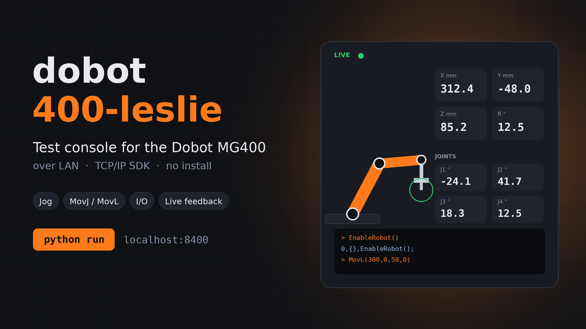

# dobot 400-leslie



A single-file test console for the **Dobot MG400** (4-axis desktop arm), controlled from your PC over a LAN cable. It lets you try out the robot's TCP/IP SDK from a browser UI: power control, jogging, moves, I/O, live feedback and a raw command console.

> **Assumption:** "Dobot 400" = **MG400**. This will not work for the Magician or other Dobot models, which use different protocols.
> **Status:** untested against real hardware. Go slowly on first moves.

---

## How it works

Browsers can't open raw TCP sockets, and the MG400 speaks plain TCP. So `dobot_400_leslie.py` does two jobs:

1. Serves the web UI at `http://localhost:8400`
2. Bridges the UI to the robot over TCP

```
Browser UI  <--HTTP-->  dobot_400_leslie.py  <--TCP-->  MG400 controller
                                                         29999 dashboard
                                                         30003 motion
                                                         30004 feedback (8 ms)
```

## Requirements

- Python 3.8 or newer (standard library only, nothing to `pip install`)
- MG400 controller firmware **1.5.4.0 or newer** (Dobot recommends **1.6.0.0+** if you have connection problems)
- An Ethernet cable between your PC and the controller

## Setup

1. **Cable:** plug into the **LAN1** port on the controller. Default robot IP is `192.168.1.6`. (LAN2 is `192.168.2.6`; wireless is `192.168.9.1`.)
2. **PC network:** set your Ethernet adapter to a fixed IP on the same subnet, for example:
   - IP: `192.168.1.100`
   - Mask: `255.255.255.0`
   - Gateway: leave blank
3. **Test:** `ping 192.168.1.6` should reply.
4. **Run:**
   ```bash
   python dobot_400_leslie.py
   ```
   Optional: pass a different UI port, e.g. `python dobot_400_leslie.py 9000`.
5. Your browser opens `http://localhost:8400`. Click **Connect**, then **Enable**, and wait until the mode reads **Enabled (idle)**.

## Features

| Panel | What it does | Commands used |
|---|---|---|
| Live feedback | X/Y/Z/R, joint angles J1–J4, robot mode, speed scaling, DO/DI bits | port 30004 stream |
| Power & state | Enable, disable, clear error, reset, continue queue, drag-teach, queries | `EnableRobot`, `DisableRobot`, `ClearError`, `ResetRobot`, `Continue`, `StartDrag`, `StopDrag`, `RobotMode`, `GetPose`, `GetAngle`, `GetErrorID` |
| Jog | Relative steps in X/Y/Z/R or per joint (1–50 mm/°) | `RelMovL`, `RelJointMovJ` |
| Go to position | Move to Cartesian or joint targets | `MovJ`, `MovL`, `JointMovJ`, `Sync` |
| Motion parameters | Speed/acceleration sliders, user and tool frames | `SpeedFactor`, `AccJ`, `AccL`, `SpeedJ`, `SpeedL`, `CP`, `User`, `Tool` |
| I/O | Toggle DO 1–8, tool outputs, read DI/DO | `DO`, `ToolDO`, `DI` |
| Saved points | Record the current pose, jump back, replay in order | `MovJ` |
| Console | Send any SDK command to either port | anything, e.g. `Arc`, `Circle` |

The **Run read-only diagnostics** button runs only query commands and never moves the arm. Use it first to check the connection.

## Robot modes shown in the UI

| Code | Mode | Code | Mode |
|---|---|---|---|
| 1 | Initializing | 7 | Running |
| 2 | Brake released | 8 | Recording |
| 3 | Powered off | 9 | **Error** |
| 4 | Disabled | 10 | Paused |
| 5 | Enabled (idle) | 11 | Jogging |
| 6 | Backdrive | | |

## Safety

- The arm moves **immediately** when a command is sent. Keep the workspace clear and your hand near the physical E-stop.
- The red **STOP** button only sends `DisableRobot()`. It is not a safety stop. Use the hardware E-stop in an emergency.
- Start with small jog steps (1–10 mm) and verify the axis directions before larger moves.
- Check the MG400's reachable workspace before typing coordinates into Go to position. Out-of-range targets will be rejected or raise an alarm.
- Saved-point replay uses `MovJ`, which is not a straight line. Check the path between points for obstacles.

## Troubleshooting

| Problem | Fix |
|---|---|
| Connect fails | Confirm cable is in LAN1, PC IP is `192.168.1.x`, and `ping 192.168.1.6` works. Disable VPNs and Wi-Fi-only firewall profiles that block local traffic. |
| Connects but "no feedback" | Firmware may be too old for port 30004. Upgrade to 1.6.0.0+. |
| Dashboard commands work, moves do nothing | The motion queue may be blocked. Click **Clear error**, then **Continue queue**. |
| Mode stuck on ERROR | Run `GetErrorID()` in the console and check the alarm code in Dobot's docs, fix the cause, then **Clear error**. |
| Arm won't enable | Check the E-stop is released and the controller has finished booting. |
| Port 8400 in use | Run with another port: `python dobot_400_leslie.py 8401`. |

## Notes on the implementation

- Feedback packets are 1440 bytes. The script reads mode, speed scaling, DI/DO bits, joint angles and Cartesian pose from fixed offsets. If your firmware uses a different layout, the live numbers could be wrong while commands still work. Verify against `GetPose()` and `GetAngle()` in the console.
- The motion port (30003) is treated as send-only; a reply, if the firmware sends one, is shown in the console.
- Commands are validated to look like `Name(args)` and are capped in length before being sent.
- Saved points are stored in your browser's `localStorage` on `localhost`.
- The server listens on `127.0.0.1` only, so other machines on your network can't reach the UI.

## References

- Dobot TCP/IP protocol: https://github.com/Dobot-Arm/TCP-IP-Protocol
- Official Python wrapper for 4-axis robots: https://github.com/Dobot-Arm/TCP-IP-4Axis-Python

## Files

```
dobot_400_leslie.py             the app (UI + bridge in one file)
dobot_400_leslie_thumbnail.png  preview image
README.md                       this file
```
